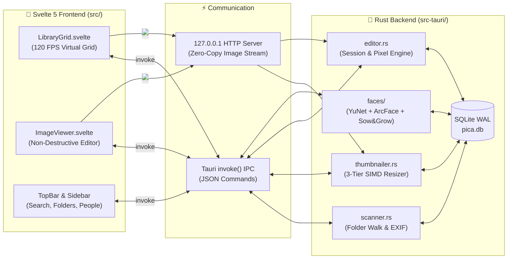

# 🏗️ Pica Architecture (In Plain English)

> **TL;DR:** The **Svelte 5** frontend draws the pretty UI, the **Rust (Tauri v2)** backend does all the heavy math on background CPU threads, **SQLite** remembers where your photos are, and a tiny **localhost HTTP server** streams images to the screen at 120 FPS.

---

## 🗺️ The Big Picture (5-Second Diagram)

---

## 🧱 The 4 Pillars of Pica

### 1. Why Scrolling 20,000 Photos Doesn't Lag (`thumbnailer.rs` + `server.rs`)

> **TL;DR:** Sending thousands of photos over Tauri's normal JSON bridge chokes the browser. Instead, Rust spins up a tiny local web server on `127.0.0.1` and streams raw JPEG bytes straight to `` tags.

- **3-Tier Resolution Pipeline (`src-tauri/src/thumbnailer.rs`):**
  1. **Tier 0 (64px micro-thumb):** Extracted in `<1ms` directly from your camera's embedded EXIF preview so you never see a blank grey box.
  2. **Tier 1 (240px standard thumb):** Used for normal grid browsing, resized with SIMD instructions (`fast_image_resize`).
  3. **Tier 2 (480px Retina thumb):** Generated on-demand when you zoom the thumbnail slider all the way up.
- **Dual-Queue Priority Scheduler:**
  - **High-Priority LIFO Stack:** Generates thumbnails for the exact photos currently visible on your screen *right now*.
  - **Low-Priority Background Worker:** Quietly pre-generates thumbnails for the rest of your library while you aren't scrolling, yielding immediately whenever you touch the scrollbar.

---

### 2. Non-Destructive Editing That Survives Restarts (`editor.rs`)

> **TL;DR:** When you crop, straighten, or fix red-eye, Pica never ruins your original file. It records each step in a `session.json` file so you can hit `Ctrl+Z` even next week. When you click **Save to Disk**, it backs up your untouched photo into a hidden `.pica_originals/` folder first.

- **Draft Sessions (`~/.local/share/pica/edits/<file_hash>/`):**
  - Every click (Crop, Straighten, Redeye, I'm Feeling Lucky, Auto Contrast, Auto Color, Retouch, Text, Fill Light) appends a step to `session.json` and renders a fast preview proxy (`step_001.jpg`, `step_002.jpg`).
  - Because the steps live on disk in `session.json`, closing Pica and reopening it tomorrow keeps your full Undo/Redo stack intact.
- **Safe Saving (`.pica_originals/`):**
  - When you press **Save to Disk (`Ctrl+S`)**, Pica copies the pristine original into `.pica_originals/<filename>` in the same folder (just like Picasa 3.9 did) and writes your edited image to the main file path so your OS file manager sees the updated photo immediately.
  - Changed your mind 3 years later? Click **Revert to Original** and Pica restores the untouched file from `.pica_originals/`.
- **External Conflict Detection:**
  - If you edit a photo in GIMP while Pica has an unsaved draft, Pica notices the file size/timestamp changed and politely asks whether to keep the external version, overwrite with your Pica draft, or save as a copy.

---

### 3. 100% Offline Face Detection & Grouping (`faces/`, `yunet_face/`, `picasa_face/`)

> **TL;DR:** Pica finds faces, turns each face into a 512-number fingerprint, and groups matching faces into People albums using Picasa's classic two-step "Sow & Grow" clustering algorithm. *(Want the full deep dive? Read **[`docs/face-detection.md`](face-detection.md)**!)*

1. **Detection (`src-tauri/src/faces/detector.rs` + `yunet_face/`):**
   - Uses **YuNet** (`yunet.onnx`, compiled directly into the binary) to find face bounding boxes and 5 facial landmarks (both eyes, nose tip, mouth corners).
2. **5-Point Alignment & Embedding (`src-tauri/src/faces/embedder.rs`):**
   - Warps the face using a 2D similarity transform so the eyes, nose, and mouth line up in a canonical `112×112` square.
   - Runs **MobileFaceNet** (`w600k_mbf.onnx`) to compute a 512-dimensional L2-normalized vector (a mathematical fingerprint of that face).
3. **Picasa "Sow & Grow" Clustering (`picasa_face/src/clustering.rs`):**
   - **Step 1 — Sow (Strict Core Seeds, similarity $\ge 0.60$):** Only nearly identical faces are linked together to form high-confidence "Person Seeds" (preventing false merges between different people).
   - **Step 2 — Grow (Centroid Expansion, similarity $\ge 0.50$):** Remaining faces are compared against the average fingerprint (centroid) of those seeds, pulling in side-profile or differently lit shots of the same person.
   - **Co-occurrence Guard:** Two faces appearing in the *exact same photo* can never be grouped into the same person!

---

### 4. Release vs. Dev Mode Feature Gating (`import.meta.env.DEV`)

> **TL;DR:** If a button doesn't save real pixels to disk yet, it's wrapped in `{#if import.meta.env.DEV}` so regular users never click a fake button.

- **In Development (`npm run tauri dev`):** `import.meta.env.DEV` is `true`. You see all 5 editor tabs (`Basic`, `Tuning`, `Effects`, `Styles`, `Frames`), the Photo Tray `Export` button, thumbnail card hover rotate buttons, and the TopBar `Bug` debug menu.
- **In Production (`npm run tauri build`):** `import.meta.env.DEV` is `false`. Vite strips those unfinished UI elements out completely so the release binary only shows 100% working features.

---

## 📂 Where Everything Lives in the Repo

| Folder / File | What's Inside (Layman Terms) |
| :--- | :--- |
| [`src/`](../src) | **Svelte 5 Frontend:** All windows, grids, sliders, and buttons. |
| [`src/lib/components/LibraryGrid.svelte`](../src/lib/components/LibraryGrid.svelte) | The 120 FPS photo grid and Picasa timeline scrubber on the right edge. |
| [`src/lib/components/ImageViewer.svelte`](../src/lib/components/ImageViewer.svelte) | The double-click photo viewer + editing sidebar (Crop, Straighten, Redeye, Retouch, Text). |
| [`src/lib/api.ts`](../src/lib/api.ts) | Every function the frontend uses to talk to the Rust backend. |
| [`src-tauri/src/`](../src-tauri/src) | **Rust Backend:** Database, folder scanner, image editor, HTTP server, and face AI worker. |
| [`src-tauri/src/editor.rs`](../src-tauri/src/editor.rs) | All the actual image math (Crop suggestions, Hough horizon straighten, Red-eye repair, SpotBlend retouch, Text baking, Fill Light curves). |
| [`src-tauri/src/faces/`](../src-tauri/src/faces) | Background face scanner, ONNX model downloader/runner, and clustering bridge. |
| [`yunet_face/`](../yunet_face) | Local Rust crate wrapping the embedded `yunet.onnx` face detector. |
| [`picasa_face/`](../picasa_face) | Local Rust crate containing the two-phase Sow & Grow face clustering engine. |
