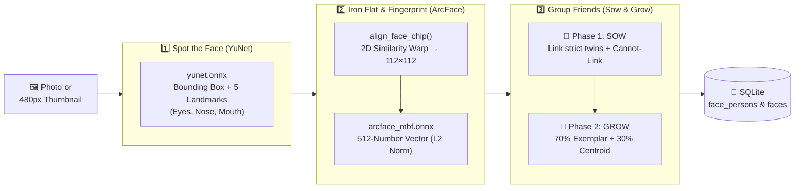

# 🧠 Face Detection & Grouping (`docs/face-detection.md`)

> **TL;DR:** Pica finds faces and groups them into People albums **100% offline on your CPU**. It uses **YuNet** to spot faces, warps them flat into a `112×112` square, uses **MobileFaceNet (ArcFace)** to turn each face into a 512-number fingerprint, and groups matching people using Google Picasa's legendary two-step **"Sow & Grow"** algorithm. Zero cloud uploads, zero subscriptions, zero creepy servers.

---

## 🗺️ The 3-Step Pipeline (5-Second Diagram)



---

## 🔍 Step-by-Step (In Plain English)

### Step 1: Spot the Face & 5 Dots (`yunet_face/` + `detector.rs`)

> **TL;DR:** Before we know *who* someone is, we have to find *where* the faces are and locate 5 key dots on each face: left eye, right eye, tip of the nose, and both corners of the mouth.

- **Model:** **OpenCV YuNet** ([`yunet_face/models/yunet.onnx`](../yunet_face/models/yunet.onnx), `0.23 MB`), baked directly into the Pica binary via `include_bytes!`.
- **Smart Thumbnail Shortcut:** Decoding a 24-megapixel JPEG just to find a face takes forever. If Pica already has a cached `480px+` thumbnail on disk, the worker loads that in `<1ms`!
- **Tiny-Face Safety Net:** What if it's a big group wedding photo and someone's face in the thumbnail is tiny (`< 80×80` pixels)? Pica notices the crop is too blurry and automatically loads the full-resolution original photo just for that face so the fingerprint stays sharp.

---

### Step 2: Iron the Face Flat & Make a 512-Number Fingerprint (`embedder.rs`)

> **TL;DR:** Neural networks hate crooked heads. If you tilt your head 30° to the left, a naive AI thinks you're a brand-new human. So we rotate and scale every face so the eyes, nose, and mouth land on the exact same pixels before computing its 512-number fingerprint.

1. **5-Point Similarity Warp (`align_face_chip` in [`src-tauri/src/faces/embedder.rs`](../src-tauri/src/faces/embedder.rs)):**
   - Takes the 5 dots from YuNet and solves a least-squares 2D similarity transform (rotation + uniform scale + translation, no weird stretching) onto a `112×112` canvas.
   - Bilinear interpolation samples the source pixels so the eyes sit horizontally at `(38.3, 51.7)` and `(73.5, 51.5)`.
2. **512-D ArcFace Embedding (`HighAccuracyFaceEmbedder` in [`src-tauri/src/faces/embedder.rs`](../src-tauri/src/faces/embedder.rs)):**
   - Feeds that aligned `112×112` RGB square into **MobileFaceNet** ([`src-tauri/models/arcface_mbf.onnx`](../src-tauri/models/arcface_mbf.onnx), `13.6 MB`, also compiled into the binary).
   - Outputs **512 numbers** normalized to length `1.0` (L2-normalized).
   - Comparing two faces is now just a single dot product (`cosine_similarity`): `1.0` means identical twins, `0.0` means completely unrelated.

---

### Step 3: Group Friends Without Creating a Franken-Cluster (`picasa_face/src/clustering.rs`)

> **TL;DR:** Grouping faces with a single threshold is a trap: make it too loose and your entire family merges into one mega-person; make it too strict and your mom gets split into 14 different albums. Picasa solved this with a two-stage **"Sow & Grow"** algorithm, and we use the exact same approach.

#### 🌱 Phase 1: SOW (Planting High-Confidence Seeds)
- **What it does:** Compares all pairs of faces using a **strict** similarity threshold (`sow_threshold`) and groups only near-certain matches using a Disjoint-Set Union-Find structure (`DisjointSet`).
- **Exemplar Stamps:** Once a seed cluster has at least 2 faces, Pica saves up to **5 "Exemplar Stamps"** (anchor faces) and calculates the cluster's average fingerprint (**centroid**).

#### 🌳 Phase 2: GROW (Expanding Around Seeds)
- **What it does:** Loops through remaining unassigned faces and checks if they match an existing seed cluster using a slightly more forgiving threshold (`grow_threshold`, default `0.50`, adjustable in the UI).
- **70% Exemplar + 30% Centroid Scoring:** Instead of only comparing against a blurry average centroid (which drifts as clusters grow), Pica scores each candidate as:
  $$\text{score} = 0.70 \times \max(\text{similarity to exemplars}) + 0.30 \times (\text{similarity to centroid})$$
  If a new face is a super-strong match and the cluster has fewer than 5 exemplars, it gets promoted to a new exemplar stamp!

#### 🚫 The Golden Rule: Same-Photo "Cannot-Link" Constraint
- **Rule:** Two faces detected in the **exact same photo** can **never** belong to the same person cluster (unless you have a time machine or a twin).
- Enforced during background scanning ([`worker.rs`](../src-tauri/src/faces/worker.rs)), during Phase 1 Sow, during Phase 2 Grow, and as a final sanitization pass when saving to SQLite ([`db.rs`](../src-tauri/src/db.rs)).

---

## 🐢 Why It Doesn't Fry Your Laptop (`worker.rs`)

> **TL;DR:** Face detection runs on 2 polite background threads that immediately get out of the way whenever you import folders or scroll the grid.

- **2 Background Threads:** `pica-face-worker-0` and `pica-face-worker-1` claim pending photos from SQLite (`face_scanned = 0`) using an atomic `ActivePhotoGuard` set so two threads never process the same photo.
- **Scanner Preemption:** While Pica is scanning your folders (`is_library_scanning == true`), the face workers sleep so folder indexing finishes at maximum speed.
- **Per-Folder Toggle:** Don't want Pica scanning your `Memes/` or `Screenshots/` folder for faces? Toggle face detection off for specific folders in the **Folder Manager** modal.

---

## 🧪 One-Click Commands to Test & Debug Faces

Click the copy icon on any block below and paste into your terminal:

### Run the Sow & Grow Clustering Unit Tests
```bash
cargo test --manifest-path picasa_face/Cargo.toml
```

### Run the YuNet Detector & Alignment Unit Tests
```bash
cargo test --manifest-path yunet_face/Cargo.toml
```

### Run the Full Backend Face Pipeline & Timing Tests
```bash
cargo test --manifest-path src-tauri/Cargo.toml faces::
```

### Live-Tune Clustering in Dev Mode
When running `npm run desktop`, click the **🐛 Bug** icon in the top-right bar to:
- Toggle **Face Detection & Grouping Overlay** (draws bounding boxes, person names, and confidence % directly over photos).
- Record and export per-photo **Face Scan Timings** (`decode_ms`, `detect_ms`, `embed_ms`, `cluster_ms`) to CSV.
- Drag the **Face Grouping (Sow-Grow)** threshold slider (`0.30` Loose → `0.50` Balanced → `0.75` Strict) and click **Re-cluster** or **Realign & Re-embed** to see clusters update in real time.

---

## 📂 Face Pipeline File Map

| File | What's Inside |
| :--- | :--- |
| [`yunet_face/src/detector.rs`](../yunet_face/src/detector.rs) | Runs `yunet.onnx` (`640×640` letterboxed) and extracts 5-point landmarks + bounding boxes. |
| [`picasa_face/src/clustering.rs`](../picasa_face/src/clustering.rs) | Pure-Rust `DisjointSet` Union-Find and two-phase `SowGrowClusterer` with exemplar stamping and cannot-link guards. |
| [`src-tauri/src/faces/mod.rs`](../src-tauri/src/faces/mod.rs) | `FaceManager` — high-level coordinator, settings, and `realign_all_embeddings()`. |
| [`src-tauri/src/faces/worker.rs`](../src-tauri/src/faces/worker.rs) | 2-thread background worker loop, thumbnail/full-res selection, and live incremental matching. |
| [`src-tauri/src/faces/detector.rs`](../src-tauri/src/faces/detector.rs) | `YuNetFaceDetector` trait adapter bridging `yunet_face` into `src-tauri`. |
| [`src-tauri/src/faces/embedder.rs`](../src-tauri/src/faces/embedder.rs) | `align_face_chip()` (2D similarity transform to `112×112`) and `HighAccuracyFaceEmbedder` (`arcface_mbf.onnx`). |
| [`src-tauri/src/faces/clustering.rs`](../src-tauri/src/faces/clustering.rs) | `SowGrowFaceClusterer` trait adapter bridging `picasa_face` into `src-tauri`. |
| [`src-tauri/src/faces/timings.rs`](../src-tauri/src/faces/timings.rs) | Per-photo latency profiler and CSV exporter. |
